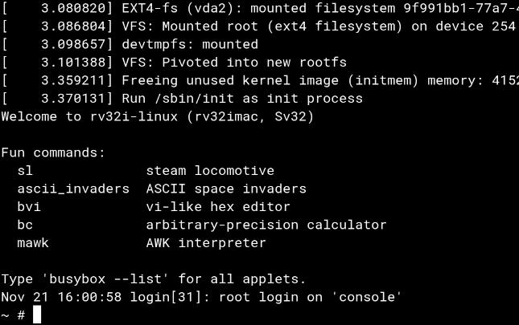

# Description

Buildroot-based Linux images for the `rv32imac` Sv32 target, booted on
[RISC-V-emulator-Native](../RISC-V-emulator-Native) through OpenSBI and U-Boot.

Two images are built from one source tree: a minimal image for the lean
emulator and a maximal image that enables every extension the emulator
implements. Each image has its own kernel, root filesystem and GPT disk.

# Target

| Item   | Value                                                                                                  |
| :----- | :----------------------------------------------------------------------------------------------------- |
| ISA    | min `rv32imac_zicsr_zifencei_zicntr` plus Sv32; max the full emulator ISA plus Sv32                    |
| ABI    | `ilp32` (no F/D)                                                                                       |
| RAM    | 64 MiB at `0x80000000`                                                                                 |
| UART   | 16550A at `0x10000000` on PLIC source 4 for `earlycon`; virtio-console at `0x10002000`, `console=hvc0` |
| Net    | virtio-net at `0x10003000`, static IPv4 and IPv6 ULA                                                   |
| RNG    | virtio-rng at `0x10004000` on PLIC source 5, host `getrandom()`                                        |
| RTC    | goldfish RTC at `0x10005000` on PLIC source 6, host realtime plus monotonic delta                      |
| CLINT  | `0x02000000`                                                                                           |
| SYSCON | `0x00100000` (poweroff/reboot)                                                                         |
| DTB    | loaded at runtime (`-b 0x82200000,artifacts/linux-mmu.dtb` or `linux-mmu-max.dtb`)                     |
| Rootfs | ext4 on a GPT disk image, attached with `-D` (`artifacts/disk.img`); no initramfs                      |

# Build

```sh
make buildroot      # clone Buildroot 2026.08.1 into the cache
make                # both images and both disks
make build          # minimal Image and rootfs.ext4
make build-max      # maximal Image and rootfs.ext4
make disk           # minimal disk image in artifacts/
make disk-max       # maximal disk image in artifacts/
make artifacts      # all final images in artifacts/
```

Buildroot source, downloads and build outputs live outside the repository in
`$XDG_CACHE_HOME/riscv-emulator` (default `~/.cache/riscv-emulator`). This
repository is a Buildroot external tree: `external.desc`, `external.mk`,
`Config.in`, the defconfigs, patches and overlay stay here. Buildroot is cloned
once, patched in the cache and never written to from the repository. Only the
final images are copied back into the gitignored `artifacts/` directory.

The build needs `dtc` and a host toolchain. Override `XDG_CACHE_HOME` to move
the cache. `make distclean` removes the outputs and artifacts but keeps the
cache; `make purge-cache` removes the Buildroot source, downloads and outputs.

`make run` also needs the boot stages from their own repos: build U-Boot with
`make -C ../RISC-V-emulator-u-boot build` and OpenSBI with
`make -C ../RISC-V-emulator-opensbi build build-max`. Both stages are pinned
and built from source.

# Run

```sh
make run            # minimal image
make run-max        # maximal image
make run-disasm     # minimal image with the instruction tracer
make run-max-disasm # maximal image with the instruction tracer
```

`make run` and `make run-max` expand to the following emulator invocations.
Build the DTBs first with `make artifacts/linux-mmu.dtb` and
`make artifacts/linux-mmu-max.dtb`, or build everything with `make artifacts`.

```sh
# minimal: OpenSBI at 0x80000000, U-Boot at 0x80400000, Linux from the disk
../RISC-V-emulator-Native/binaries/gcc/RV32I-linux-mmu \
    -b 0x82200000,artifacts/linux-mmu.dtb \
    -l 0x80000000,../RISC-V-emulator-opensbi/build-min/platform/generic/firmware/fw_jump.bin \
    -l 0x80400000,../RISC-V-emulator-u-boot/build/u-boot.bin \
    -D artifacts/disk.img

# maximal: the full emulator ISA, Sv32 and the SBI
../RISC-V-emulator-Native/binaries/gcc/RV32I-linux-mmu-max \
    -b 0x82200000,artifacts/linux-mmu-max.dtb \
    -l 0x80000000,../RISC-V-emulator-opensbi/build-max/platform/generic/firmware/fw_jump.bin \
    -l 0x80400000,../RISC-V-emulator-u-boot/build/u-boot.bin \
    -D artifacts/disk-max.img
```

Override `OPENSBI`, `OPENSBI_MAX`, `UBOOT`, `EMULATOR_DIR` or `DTS` on the
`make` command line to use other builds. Add `-m <instructions>` to stop after
a fixed instruction count, `-N <ifname>` to attach a TAP interface to
virtio-net, or `-v` for an instruction trace.

# Snapshot from Native to SimAVR

The Native emulator can write a snapshot at any point in the boot and SimAVR can continue from it. Use three commands in this order.

```sh
# 1. Start the maximal Native boot with snapshots enabled and leave it running.
../RISC-V-emulator-Native/binaries/gcc/RV32I-linux-mmu-max \
    -S boot-snapshot \
    -b 0x82200000,artifacts/linux-mmu-max.dtb \
    -l 0x80000000,../RISC-V-emulator-opensbi/build-max/platform/generic/firmware/fw_jump.bin \
    -l 0x80400000,../RISC-V-emulator-u-boot/build/u-boot.bin \
    -D artifacts/disk-max.img

# 2. In another shell, request the snapshot at the desired moment.
kill -USR1 $(pidof RV32I-linux-mmu-max)

# 3. Stop Native, then continue the same boot on SimAVR with the maximal firmware.
../RISC-V-emulator-SimAVR/binaries/gcc/simavr-host \
    -R boot-snapshot \
    -D artifacts/disk-max.img \
    ../RISC-V-emulator-AVR/hex/ATmega1284P_linux-mmu-max.hex
```

Step 2 writes `boot-snapshot.json` with the CPU and device state and `boot-snapshot.bin` with the 64 MiB guest RAM. `pidof` uses the kernel process name, which is truncated to 15 characters, so `RV32I-linux-mmu-max` appears as `RV32I-linux-mmu`. Native continues after writing the snapshot. Stop Native before step 3 so both emulators do not write the same disk image. SimAVR also accepts `-S <prefix>` and `SIGUSR1`, so a run that started on Native can be snapshotted again on SimAVR.

# Disk layout

The disk is a GPT image with a 32M ext4 boot partition at 1M and a 16M ext4
rootfs at 33M. The boot partition holds the `Image` and the DTB; U-Boot loads
them and starts the kernel. The kernel mounts the rootfs by `PARTUUID`.

- `configs/genimage-mmu.cfg` defines the layout.
- The `PARTUUID` is duplicated in the genimage config and in both DTS files in
  the emulator repo. Change it in all three places.
- The rootfs size is `BR2_TARGET_ROOTFS_EXT2_SIZE`; increase it if the rootfs
  grows.
- The initramfs is disabled; without `-D` the kernel cannot mount the root.

# Notes

- The kernel `Image` is loaded by U-Boot at `0x80600000`; OpenSBI runs in
  M-mode and provides the SBI.
- The DTB's `chosen/bootargs` is authoritative; `CONFIG_CMDLINE` is only a
  fallback.
- The kernel config enables `CONFIG_TMPFS` and BusyBox enables `FEATURE_MOUNT_FLAGS`, so the fstab `mode=`, `nosuid` and `nodev` options work.
- The emulator must implement full `M` (DIV/REM), not just `Zmmul`. OpenSBI
  uses `div` in `fw_base.S` and `riscv_barrier.h`, U-Boot hardcodes `rv32im`
  and Linux hardcodes `rv32ima`; none of the three can drop M.
- The minimal image needs `RV32I`, `M`, `A`, `Zicsr`, `Zifencei`, `Zicntr` and
  `Sv32`. OpenSBI and the kernel use this ISA set; the kernel keeps GPT through
  `CONFIG_EFI_PARTITION=y`. Build the lean emulator with:
  ```sh
  cd ../RISC-V-emulator-Native
  pio run -e RV32I-linux-mmu
  ```
- The maximal ISA string is `rv32imac_zicsr_zifencei_zicntr_zicond_zihintntl_zihintpause_zimop_zca_zcb_zcmop_zba_zbb_zbkb_zbkc_zbkx_zbs`.
  `Zbc` is omitted because the default emulator binary has `Zbkc` but not
  `Zbc`.
- The DTS files live in the emulator repo next to the hardware description;
  this project only builds the DTBs. They carry `riscv,isa-base` and
  `riscv,isa-extensions` for kernel ISA detection; the legacy `riscv,isa`
  string stays for boot stages that use it.

[](https://opensource.org/licenses/Apache-2.0)
